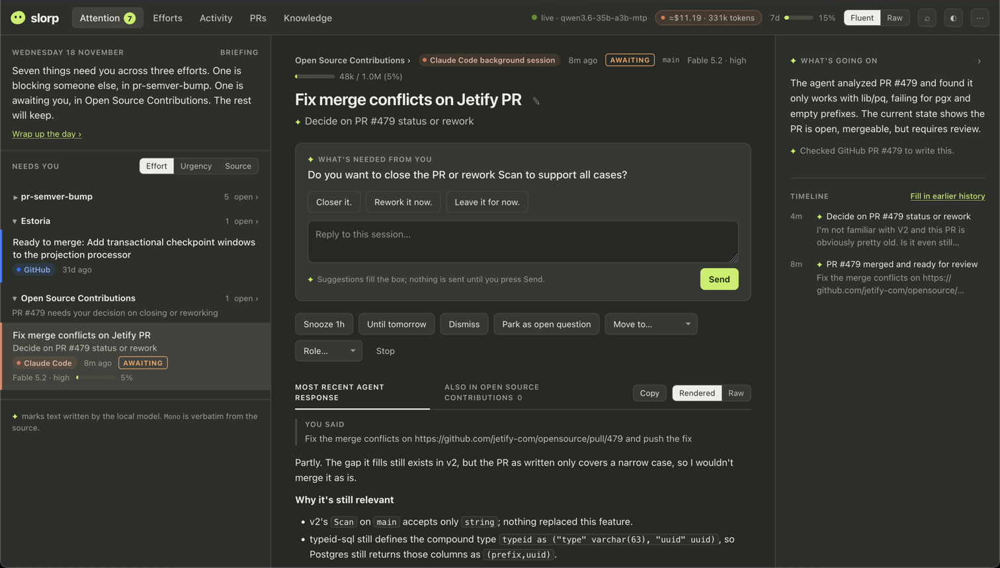

# slorp - organize your slop

Slorp helps make sense of the dozens of agent sessions running on your machine.



## Getting Started

You need [Go](https://go.dev/dl/) 1.27 or later and [Claude Code](https://claude.com/claude-code) or [OpenCode](https://opencode.ai).

1. Install Slorp.

   ```sh
   go install github.com/jefflinse/slorp@latest
   ```

2. Run it and open <http://127.0.0.1:4747>.

   ```sh
   slorp
   ```

3. Slorp detects missing agent plugins and offers to install them on the page or under **Settings → Integrations**. Claude Code sessions load their plugin after `/reload-plugins` or a restart. OpenCode needs a restart.

To try Slorp without installing it, `go run github.com/jefflinse/slorp@latest` does the same as steps 1 and 2.

Slorp lists Claude Code sessions with or without the plugin. The plugin is what lets you reply to a session and answer its permission prompts from the page. See [its README](integrations/claude-code/README.md) to install it by hand or configure it.

Summaries, suggested replies, automatic filing and the journal are written by a local model. Slorp looks for an OpenAI-compatible LLM server, such as LM Studio, Ollama or llama.cpp, at `http://localhost:1234` and uses the model it has loaded. Settings on the page points it at another server, names the model where a server offers several, turns it off, and checks that it answers. `-llm` and `-model` do the same when Slorp starts, and stand over what Settings holds for as long as it runs. Without a model Slorp still lists your sessions and lets you answer them, and the page marks what is missing. `slorp -h` lists the other options.

The [OpenCode plugin](integrations/opencode/README.md) is bundled in the Slorp executable, so installation needs no repository checkout. It discovers opened and resumed local terminal conversations even before you send a message, reports model and usage information, and lets you answer permissions and structured questions from Slorp. Settings offers updates when the installed plugin differs from the bundled copy.

## Features

- **Every session on one page.** Each open Claude Code and OpenCode session with what it is doing, what it last said, its model, how full its context is, and what it has used.
- **Attention.** The sessions that need you, whether for a question, a permission prompt or finished work to look at, each summarized by a local model.
- **Answer from the page.** Reply to a session, or allow or deny a permission prompt, without finding its terminal.
- **Efforts and roles.** Sessions are filed under the efforts they belong to, by a directory rule, by you, or by the model's guess. Efforts sit on a board of cards that you drag into the order you want. Each card lists what needs you in its effort, and then the rest of its open sessions. Opening one makes it a large card beside a column of them all collapsed, where clicking another opens that one instead. The large card is the effort's home: where it stands, what needs you, its open and closed sessions, its pull requests, the days of the journal it moved on, and what its sessions have used. Each effort has a colour and a glyph that mark it wherever it is named, and its card says when it was last active. A session is filed by dragging its row onto an effort, from the unsorted sessions listed beside the open effort or from another effort's sessions. An effort can be renamed and described again, lose a directory, be merged into another, be shelved, which takes it off the board and out of the model's choices while keeping everything filed under it, or be deleted. A role marks a kind of session, such as a reviewer on a loop, and how much of your attention it may ask for.
- **Timelines.** What you asked each session and how it came out. For open Claude Code and OpenCode sessions, **Fill in earlier history** reads earlier exchanges from the local session record and has the local model summarize them, preserving timestamps and existing summaries.
- **Journal.** A page for each day: what moved in each effort, with each thing done tied to the sessions it came from and the pull requests they were working on. The local model writes a day when you ask, and the day after if you did not. Days are tagged by the model and by you, and can be searched and narrowed to a tag.
- **Closed sessions and search.** Sessions are kept after they close, and `⌘K` searches all of them.
- **Start, stop and reopen.** Claude Code and OpenCode sessions can be started from Sessions or under an effort, stopped, and reopened from the page. Claude sessions use your chosen model and effort level, or the local model with thinking and temperature settings. OpenCode offers its directory-specific agents, provider/models and reasoning variants. Reopening an OpenCode conversation preserves its ID, effort, role and timeline; an empty prompt simply opens it. Resume commands are ready to copy. Slorp owns the headless OpenCode runtimes it starts, which close when Slorp exits; their conversations remain available to reopen.
- **One conversation, one session.** A Claude Code conversation keeps its name, effort, role and timeline when it is cleared, handed off or moved to the background.
- **Subagents.** The agents a Claude Code or OpenCode session starts to do parts of its work: nested tasks, live status, when each ran, what it used, and what it was asked and reported. OpenCode task records and reports are retained in Slorp after the session closes.
- **Pull requests.** With the GitHub integration turned on, your pull requests, the ones you are asked to review and the ones you have reviewed are listed, matched to the sessions working on them, and raised when one needs you. Each has a page of its discussion, where the local model says where it stands and sorts what waits on you: a question, pushback on your review, a request, or word that something was done. Questions and pushback are raised under Attention as well. On a pull request you have reviewed, the model also says what the code pushed since does, and whether it is what you asked for.
- **Usage.** Tokens, estimated cost and your usage limits, as the agents report them.
- **Themes.** Slorp's own look, light or dark, or The Matrix or Hot Dog Stand, chosen under Settings.
- **Local.** Slorp listens only on this machine and keeps what it knows in `~/.slorp`.
